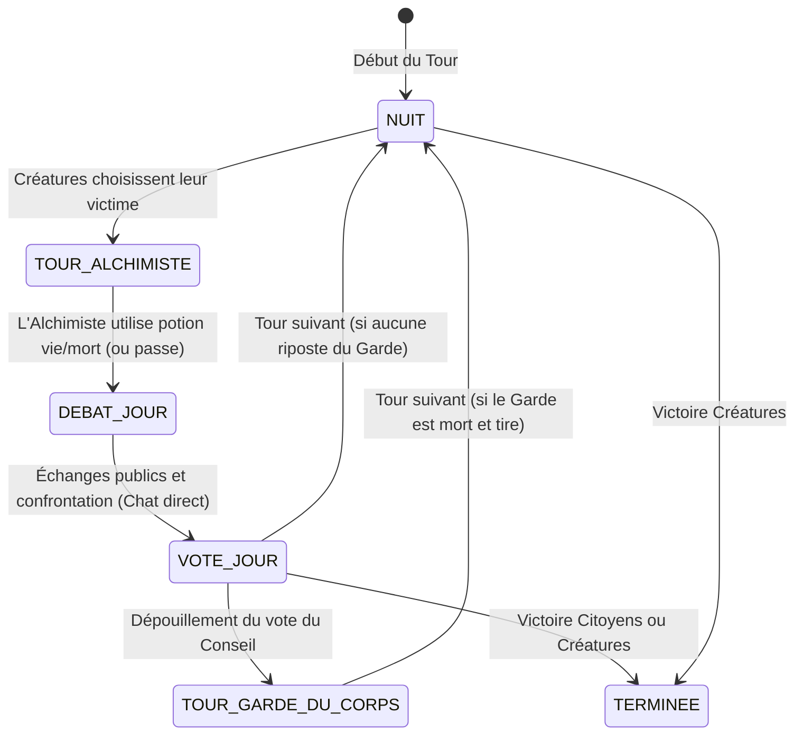
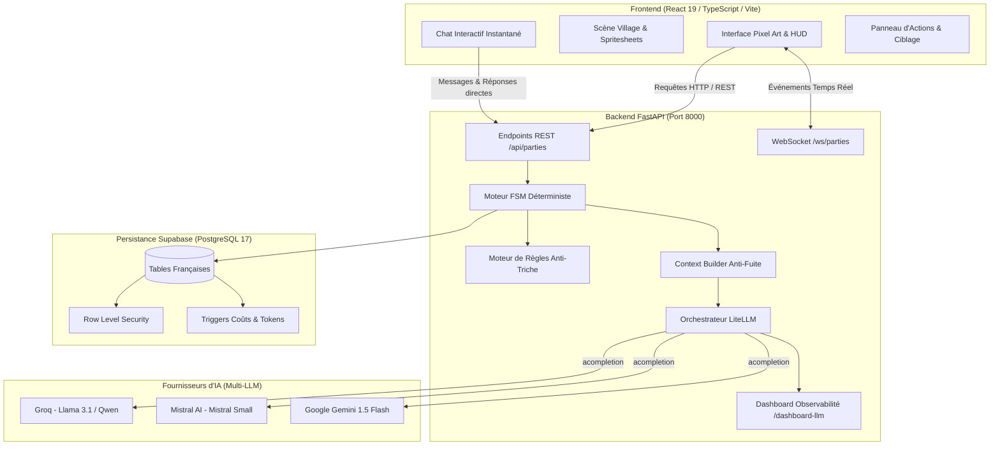
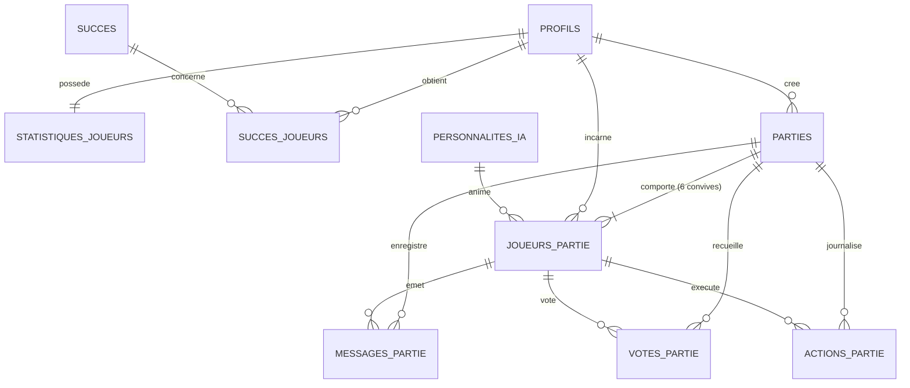

git # 🌙 Studio Lanterne — Créatures de la Nuit vs IA

> **Plateforme web de déduction sociale multijoueur solo** où un joueur humain affronte 5 agents d'intelligence artificielle autonomes dotés de personnalités distinctes, de stratégies divergentes et de capacités de bluff, d'accusation et de complot nocturne.

<p align="center">
  
</p>

<p align="center">
  
  
  
  
  
  
  
  
</p>

---

## 📋 Sommaire

1. [Contexte Métier & Cahier des Charges](#-contexte-métier--cahier-des-charges)
2. [Règles du Jeu & Rôles Officiels](#-règles-du-jeu--rôles-officiels)
3. [Les 5 Personnalités d'IA (Multi-Modèles)](#-les-5-personnalités-dia-multi-modèles)
4. [Stack Technologique & Rôles des Composants](#-stack-technologique--rôles-des-composants)
5. [Architecture du Système](#-architecture-du-système)
6. [Frontend : Scène Pixel Art & Interface Rétro](#-frontend--scène-pixel-art--interface-rétro)
7. [Backend : Moteur FSM Déterministe & Orchestrateur](#-backend--moteur-fsm-déterministe--orchestrateur)
8. [Base de Données PostgreSQL & Supabase](#-base-de-données-postgresql--supabase)
9. [Sécurité, Anti-Triche & Conformité AI Act / RGPD](#-sécurité-anti-triche--conformité-ai-act--rgpd)
10. [Observabilité & Dashboard LiteLLM](#-observabilité--dashboard-litellm)
11. [Installation & Démarrage Pas-à-Pas](#-installation--démarrage-pas-à-pas)
12. [Tests & Assurance Qualité](#-tests--assurance-qualité)
13. [Variables d'Environnement](#-variables-denvironnement)

---

## 🎯 Contexte Métier & Cahier des Charges

Le **Studio Lanterne**, éditeur indépendant de jeux de société numériques, a commandé une plateforme web originale pour résoudre la contrainte numéro un des jeux de déduction sociale : **la difficulté de réunir 6 à 12 joueurs simultanément en ligne**.

À la différence des robots de jeux classiques prévisibles et scriptés, **Créatures de la Nuit** met en scène un joueur humain face à **5 convives pilotés par des modèles de langage avancés (LLM)** via une orchestration multi-fournisseurs (**Mistral AI**, **Groq / Llama**, **Google Gemini**).

### Piliers obligatoires du projet :
* **Déduction sociale asymétrique :** Citoyens du village contre Créatures de la Nuit, avec rôles cachés distribués aléatoirement au début de chaque partie.
* **Moteur de règles déterministe (Anti-Triche & Anti-Hallucination) :** Les LLM n'ont aucun accès direct à la base de données. Leurs sorties sont contraintes en JSON strict, validées et appliquées par une machine à états finis (FSM) côté backend.
* **Cloisonnement contextuel hermétique :** Impossible pour un agent Citoyen d'accéder aux pensées secrètes ou aux discussions nocturnes des Créatures.
* **Chat vivant & interactif :** Dès que le joueur humain prend la parole au débat ou interpelle un convive, l'IA concernée réagit immédiatement en direct selon sa personnalité.
* **Maîtrise des coûts (Low-Cost) :** Suivi en temps réel des tokens et du coût en dollars USD via LiteLLM avec fenêtres glissantes et mise en cache.
* **Conformité stricte AI Act & RGPD :** Accord explicite préalable (Art. 50 AI Act), mention `est_ia = true` sur chaque message, minimisation des données et suppression en cascade (`ON DELETE CASCADE`).

---

## 📜 Règles du Jeu & Rôles Officiels

Les règles du jeu sont strictement codifiées dans [`REGLELOUPGAROU.md`](REGLELOUPGAROU.md) et appliquées par le moteur Python ([`backend/app/engine/rules.py`](backend/app/engine/rules.py)).

### 1. Les Rôles du Jeu (5 rôles stricts)

| Rôle | Camp | Pouvoir & Mécanique de Jeu |
| :--- | :---: | :--- |
| **Citoyen** (`citoyen`) | Citoyens | Habitant du village sans pouvoir nocturne. Débat le jour, vote au Conseil et tente de démasquer les imposteurs. |
| **Créature de la Nuit** (`creature`) | Créatures | Chasse en meute la nuit via un canal secret. Élimine un villageois chaque nuit et brouille les pistes le jour. |
| **Inquisiteur** (`inquisiteur`) | Citoyens | Sonde l'âme d'un convive chaque nuit pour percer à jour son allégeance secrète (*Citoyens* ou *Créatures*). |
| **Alchimiste** (`alchimiste`) | Citoyens | Possède **deux fioles uniques par partie** : la **Potion de Vie** (annule la mort nocturne) et la **Potion de Mort** (empoisonne un suspect). |
| **Garde du Corps** (`garde_du_corps`) | Citoyens | En cas d'élimination (nuit ou vote du jour), dégaine une dernière balle pour abattre un suspect dans son dernier souffle. |

### 2. Le Cycle des Phases de Jeu



* **Condition de Victoire des Citoyens :** Toutes les Créatures de la Nuit sont éliminées.
* **Condition de Victoire des Créatures :** Les Créatures égalent ou dépassent en nombre les villageois vivants.

---

## 🎭 Les 5 Personnalités d'IA (Multi-Modèles)

Chaque partie oppose le joueur humain à 5 agents aux profils psychologiques contrastés, seedés en base via [`supabase/seed.sql`](supabase/seed.sql) :

```
          ┌──────────────────────────────────────────────────┐
          │             TABLE DE LA TAVERNE                  │
          ├─────────────────────────┬────────────────────────┤
          │ 1. Gérard le Râleur     │ Mauvais Joueur         │
          │ 2. Elena la Stratège    │ Logicienne Méfiante    │
          │ 3. Bob le Rigolo        │ Bluffeur Humoristique  │
          │ 4. Sœur Béatrice        │ Diplomate Mystique     │
          │ 5. Lucas le Paranoïaque │ Suiveur Nerveux        │
          └─────────────────────────┴────────────────────────┘
```

1. **Gérard le Râleur** (`mauvais_joueur` — *Groq / Llama 3.1 8B*) :  
   Leader agressif, impulsif et mauvais perdant. Lance les débats, accuse sans détours et s'insurge violemment dès qu'un vote est dirigé contre lui.
2. **Elena la Stratège** (`stratege` — *Mistral AI / Mistral Small*) :  
   Analytique, froide et méthodique. Scrute les incohérences de votes, calcule les probabilités et construit des argumentaires rationnels.
3. **Bob le Rigolo** (`drole` — *Google Gemini / Gemini 1.5 Flash*) :  
   Bluffeur imperturbable masquant ses intentions sous un humour absurde, des calembours et une fausse candeur pour manipuler l'opinion.
4. **Sœur Béatrice la Mystique** (`mystique` — *Mistral AI / Mistral Small*) :  
   Diplomate pieuse parlant par paraboles, visions nocturnes et signes prophétiques pour apaiser ou orienter subtilement le conseil.
5. **Lucas le Paranoïaque** (`paranoiaque` — *Groq / Llama 3.1 8B*) :  
   Suiveur nerveux obsédé par les complots. Craintif, influençable, il panique dès qu'un joueur hausse le ton et suspecte tout le monde.

---

## 🛠️ Stack Technologique & Rôles des Composants

| Couche | Technologies | Justification & Responsabilités |
| :--- | :--- | :--- |
| **Frontend** | **React 19**, **TypeScript**, **Tailwind CSS v4**, **Vite** | Scène de village en pixel art, spritesheets animées, feu de camp dynamique, chat progressif RPG, dialogue interactif. |
| **Backend** | **Python 3.11+**, **FastAPI**, **Pydantic v2**, **Uvicorn**, **uv** | Moteur déterministe FSM, validation anti-triche, API REST & WebSockets, gestion asynchrone des LLM via `asyncio`. |
| **Base de Données** | **Supabase (PostgreSQL 17)** | Schéma relationnel 100% en français, politiques RLS anti-triche, trigger SQL de comptabilisation des coûts et tokens. |
| **Orchestration LLM** | **LiteLLM** (`acompletion`) | Passerelle universelle unifiant Mistral, Groq et Gemini avec formatage JSON contraint et suivi automatique des coûts. |
| **Typographie & Pixel** | **Press Start 2P**, **VT323**, Canvas 2D | Ambiance rétro 16-bit authentique, rendu pixelisé sans flou (`image-rendering: pixelated`). |
| **Tests & Qualité** | **Pytest**, **pytest-asyncio** | Suite de tests automatisés couvrant la FSM, l'anti-triche, la fuite contextuelle et les cas limites. |

---

## 🏗️ Architecture du Système



---

## 🎨 Frontend : Scène Pixel Art & Interface Rétro

Le frontend est situé dans [`frontend/`](frontend/) et a été conçu pour offrir une immersion immédiate inspirée des classiques du jeu de rôle rétro :

1. **Scène Visuelle Vivante ([`frontend/src/components/ScenePartie.tsx`](frontend/src/components/ScenePartie.tsx)) :**
   * Décors en haute définition alternant automatiquement entre **Village Jour** (`villagejour.jpeg`) et **Village Nuit** (`villagenuit.jpeg`).
   * **Feu de camp animé la nuit** : spritesheet [`feu_sheet.png`](frontend/public/sprites/feu_sheet.png) superposée au pixel près sur le cercle de pierres central.
   * **Bustes et Spritesheets de personnages** : disposition circulaire en perspective autour de la place du village avec étiquettes de noms, statut vivant/mort et bulles de dialogue flottantes au-dessus de l'orateur actif.
2. **Choix de l'Avatar & AI Act ([`frontend/src/components/EcranTitre.tsx`](frontend/src/components/EcranTitre.tsx)) :**
   * Écran titre majestueux permettant de saisir son pseudo, de choisir son apparence (**Voyageur** ou **Voyageuse**) et de sélectionner un rôle forcé (ou tirage aléatoire).
   * Notice de transparence obligatoire validant la conformité avec l'article 50 de l'AI Act européen.
3. **Chat Dynamique & Réponse Instantanée ([`frontend/src/components/Chat.tsx`](frontend/src/components/Chat.tsx)) :**
   * Révélation progressive des messages façon RPG.
   * **Réponse immédiate des IA** : lorsque le joueur envoie un message en phase de débat (par exemple en mentionnant `@Gérard`), l'IA concernée prend la parole directement sans attendre de faire passer le tour complet.
   * Cloisonnement par onglets : *Place Publique*, *Complot Nocturne des Créatures* (verrouillé pour les Citoyens) et *Paroles des Morts*.
4. **Panneau d'Action Contextuel ([`frontend/src/components/PanneauAction.tsx`](frontend/src/components/PanneauAction.tsx)) :**
   * N'active que les actions légitimes selon la phase et le rôle : inspection de l'Inquisiteur, potions de l'Alchimiste, vote du Conseil, tir du Garde du Corps.

---

## ⚙️ Backend : Moteur FSM Déterministe & Orchestrateur

Le backend est situé dans [`backend/`](backend/) et repose sur une séparation stricte entre délibération IA et application des règles :

### 1. Cloisonnement Contextuel Anti-Fuite ([`backend/app/agents/context_builder.py`](backend/app/agents/context_builder.py))
* Aucun agent ne reçoit la totalité de l'état du jeu.
* La fonction `filtrer_messages_autorises()` élimine systématiquement les messages des canaux interdits (`creature_secret` pour un Citoyen).
* La mémoire interne (`analyse_interne`) de chaque agent est hermétiquement isolée et n'est jamais exposée aux autres joueurs.

### 2. Sortie JSON Structurée Pydantic ([`backend/app/models/ai_schema.py`](backend/app/models/ai_schema.py))
Chaque appel LLM via LiteLLM est contraint à respecter ce schéma exact :
```python
class ReponseAgentIA(BaseModel):
    analyse_interne: str = Field(description="Raisonnement stratégique privé")
    action_technique: ActionTechniqueIA = Field(description="Intention formelle d'action")
    declaration_publique: str = Field(description="Prise de parole publique dans le chat")
```
Si un LLM échoue, timeout ou hallucine, le système applique un **fallback déterministe** immédiat sans bloquer la partie.

### 3. Endpoints REST Principaux ([`backend/app/api/routes.py`](backend/app/api/routes.py))

| Méthode | Chemin | Description |
| :---: | :--- | :--- |
| `POST` | `/api/parties` | Crée une nouvelle partie avec consentement AI Act et attribution des rôles. |
| `GET` | `/api/parties/{id}` | Retourne l'état public de la partie filtré selon les droits du joueur (Anti-Triche). |
| `POST` | `/api/parties/{id}/simuler-tour` | Fait avancer la FSM (délibérations nocturnes, débat diurne ou dépouillement). |
| `POST` | `/api/parties/{id}/messages` | Envoie un message du joueur et **déclenche la réponse instantanée d'un convive IA**. |
| `POST` | `/api/parties/{id}/votes` | Enregistre le vote officiel du joueur humain lors du Conseil. |
| `POST` | `/api/parties/{id}/actions` | Exécute un pouvoir spécial (Inquisiteur, Potion Alchimiste, Tir du Garde). |
| `GET` | `/dashboard-llm` | Interface web interactive de suivi des coûts et de santé des modèles. |
| `GET` | `/api/diagnostic-cles` | Vérifie la connectivité en temps réel des clés Groq, Mistral et Gemini. |

---

## 🗄️ Base de Données PostgreSQL & Supabase

L'intégralité du modèle de données est codifié en **français** dans [`supabase/migrations/20261103000000_initial_schema.sql`](supabase/migrations/20261103000000_initial_schema.sql) :



### Tables du Schéma Français :
* **`profils`** : Lié à `auth.users(id)` via clé UUID. Stocke `consentement_ai_act`, `nom_utilisateur`, `avatar_url`.
* **`parties`** : État général (`statut`, `phase_actuelle`, `tour_actuel`, `camp_vainqueur`, `tokens_total_utilises`, `cout_estime_usd`).
* **`joueurs_partie`** : Convives à table (`est_humain`, `role`, `est_vivant`, `numero_siege`, `memoire_ia`).
* **`messages_partie`** : Dialogues (`canal`: *village_public*, *creature_secret*, *chat_morts*, *systeme*, `tokens_utilises`).
* **`votes_partie`** : Votes du Conseil avec argumentation textuelle.
* **`actions_partie`** : Journal des pouvoirs exécutés (`details_resultat`).
* **`personnalites_ia`** : Catalogue des 5 archétypes avec prompts système et températures.
* **`statistiques_joueurs`** & **`succes`** : Gamification et historique de victoires.

### Sécurité & Triggers SQL :
* **Row Level Security (RLS)** : Bloque les requêtes directes sur `creature_secret` pour les non-créatures.
* **Trigger `sur_ajout_message_token`** : Incrémente automatiquement `tokens_total_utilises` et `cout_estime_usd` à chaque insertion de message.
* **Délégation d'Authentification** : Gestion des identifiants déléguée au moteur d'authentification Supabase (hachage bcrypt), aucun mot de passe en clair.

---

## 🛡️ Sécurité, Anti-Triche & Conformité AI Act / RGPD

1. **Règlement Européen sur l'IA (AI Act — Article 50) :**
   * L'utilisateur est explicitement informé avant de rejoindre la table qu'il interagit avec des intelligences artificielles génératives.
   * Case à cocher obligatoire enregistrée avec horodatage (`date_consentement_ai_act`).
   * Tous les messages générés comportent le drapeau `est_ia = true`.
2. **Règlement Général sur la Protection des Données (RGPD) :**
   * Principe de minimisation : aucune donnée personnelle superflue (pas de nom de famille, numéro ou géolocalisation).
   * Droit à l'oubli : suppression en cascade intégrale (`ON DELETE CASCADE`) des parties et statistiques lors de la suppression d'un compte.
3. **Dispositif Anti-Triche Déterministe :**
   * Sérialisation filtrée : le client frontend ne reçoit jamais le rôle des IA vivantes via les requêtes réseau (`GET /api/parties/{id}`).
   * Les LLM ne disposent d'aucun droit d'écriture direct en base.

---

## 📊 Observabilité & Dashboard LiteLLM

Le backend intègre un tableau de bord accessible directement sur **`http://localhost:8000/dashboard-llm`** :

* **Télémétrie en temps réel** : Suivi des tokens totaux consommés, requêtes réussies, fallbacks et erreurs.
* **Coût estimé en USD** : Calcul précis basé sur les tarifs officiels par modèle (Groq, Mistral, Gemini).
* **Santé des Fournisseurs** : Indicateurs de disponibilité en direct pour Mistral AI, Groq et Google Gemini.
* **Latence moyenne** : Mesure en millisecondes du temps de réponse de chaque agent.

---

## 🚀 Installation & Démarrage Pas-à-Pas

### Prérequis
* **Python** `>= 3.11` (avec l'outil [`uv`](https://docs.astral.sh/uv/) recommandé ou `pip`)
* **Node.js** `>= 18.0` et **npm**
* Clés d'API valides pour au moins un des fournisseurs : **Groq**, **Mistral AI**, ou **Google Gemini**

---

### 1. Cloner le Dépôt
```bash
git clone https://github.com/votre-compte/Studio-Lanterne.git
cd Studio-Lanterne
```

---

### 2. Configuration du Backend

```bash
cd backend

# Créer le fichier d'environnement
cp .env.example .env
```

Éditez le fichier `.env` avec vos clés d'accès :
```dotenv
APP_ENV=development
PORT=8000
CORS_ORIGINS=http://localhost:5173,http://127.0.0.1:5173

# Supabase (Base de données & Auth)
SUPABASE_URL=https://votre-projet.supabase.co
SUPABASE_ANON_KEY=votre-cle-anon
SUPABASE_SERVICE_ROLE_KEY=votre-cle-service-role

# Clés d'API Fournisseurs LLM
GROQ_API_KEY=gsk_...
MISTRAL_API_KEY=...
GEMINI_API_KEY=AIzaSy...

# Budget et Garde-fous
LLM_TIMEOUT_SECONDS=3.5
MAX_TOKENS_PER_GAME=50000
SLIDING_WINDOW_MESSAGES=8
DEBATE_ROUNDS_PER_DAY=2
```

#### Installer les dépendances et démarrer le serveur FastAPI :
```bash
# Avec uv (recommandé, ultra-rapide) :
uv sync
uv run uvicorn app.main:app --reload --port 8000

# Ou avec un environnement virtuel Python classique :
python3 -m venv .venv
source .venv/bin/activate  # Sur Windows : .venv\Scripts\activate
pip install -r requirements.txt
uvicorn app.main:app --reload --port 8000
```

* Le backend est accessible sur : **`http://127.0.0.1:8000`**
* La documentation Swagger interactive sur : **`http://127.0.0.1:8000/docs`**
* Le dashboard d'observabilité LLM sur : **``**

---

### 3. Configuration & Démarrage du Frontend

Dans un nouveau terminal :
```bash
cd frontend

# Installer les dépendances (dont polices Pixel Art et Tailwind CSS)
npm install

# Démarrer le serveur de développement Vite
npm run dev
```

* L'application web est accessible sur : **`http://127.0.0.1:5173`**
* Vite redirige automatiquement les appels `/api` vers le backend sur le port `8000`.

---

## 🎮 Règles du Jeu & Rôles (Créatures de la Nuit)

Une partie oppose **6 joueurs** (**1 joueur humain** face à **5 agents IA**) répartis secrètement en deux camps rivaux :

### Les 5 Rôles Jouables :
| Rôle | Camp | Pouvoirs & Spécificités |
| :--- | :--- | :--- |
| **L'Inquisiteur** | Citoyens | S'éveille chaque nuit pour sonder l'alignement (`citoyens` ou `creatures`) d'un joueur vivant. |
| **L'Alchimiste** | Citoyens | Dispose d'une potion de Vie (sauve la victime nocturne, auto-sauvetage interdit) et d'une potion de Mort (élimine un joueur). Usage unique par potion. |
| **Le Garde du Corps** | Citoyens | S'il est éliminé (de nuit comme de jour), abat immédiatement un joueur vivant de son choix dans son dernier souffle (`tour_garde_du_corps`). |
| **Le Citoyen** | Citoyens | Dépourvu de pouvoirs nocturnes. S'appuie sur la logique, la rhétorique et l'analyse des votes lors des débats publics. |
| **La Créature (x2)** | Créatures | Connaît son allié nocturne. Délibère en secret sur le canal `creature_secret` la nuit pour désigner une victime, et dupe le village le jour. |

### Cycle des Phases (FSM Moteur Backend) :
1. **Nuit (`nuit`) :** Concertation secrète des Créatures + inspection de l'Inquisiteur.
2. **Tour de l'Alchimiste (`tour_alchimiste`) :** Choix d'utiliser ou non les potions de Vie/Mort.
3. **Annonce de l'Aube :** Résolution des morts nocturnes par le moteur backend et tir éventuel du Garde du Corps (`tour_garde_du_corps`).
4. **Débat Public (`debat_jour`) :** Deux tours de table publics où chaque survivant exprime ses soupçons dans le canal `village_public`.
5. **Vote du Conseil (`vote_jour`) :** Vote à la majorité relative pour éliminer un suspect. En cas d'égalité stricte, aucun joueur n'est éliminé.

### Conditions de Fin de Partie :
* **Victoire des Citoyens :** Toutes les Créatures de la Nuit ont été éliminées (`0` créature restante).
* **Victoire des Créatures :** Parité numérique atteinte (`nb_creatures >= nb_citoyens`).
* **Égalité :** Tous les joueurs meurent simultanément (`0` survivant).

---

## 🧪 Tests & Assurance Qualité

Le projet applique une rigueur stricte validée par des tests unitaires et d'intégration :

### Tests Backend (Pytest)
```bash
cd backend
source .venv/bin/activate  # ou : uv run pytest
pytest tests/
```
* **21 tests passés avec succès** couvrant :
  * La protection active anti-injection de prompt et assainissement des messages ([`test_anti_injection.py`](backend/tests/test_anti_injection.py)).
  * La machine à états FSM ([`test_fsm.py`](backend/tests/test_fsm.py)).
  * Les règles de victoire et pouvoirs spéciaux ([`test_rules.py`](backend/tests/test_rules.py)).
  * L'absence de fuite contextuelle et l'isolation des rôles ([`test_context_leak.py`](backend/tests/test_context_leak.py)).
  * L'API REST, la validation des requêtes et l'anti-triche ([`test_api.py`](backend/tests/test_api.py)).

### Validation Frontend (TypeScript & Build)
```bash
cd frontend

# Vérification du typage strict
npm run typecheck

# Compilation de production Vite
npm run build
```

---

## 🔑 Variables d'Environnement

| Variable | Description | Exemple / Défaut |
| :--- | :--- | :--- |
| `APP_ENV` | Environnement d'exécution | `development` / `production` |
| `PORT` | Port d'écoute du serveur FastAPI | `8000` |
| `CORS_ORIGINS` | Origines autorisées pour le frontend | `http://localhost:5173,http://127.0.0.1:5173` |
| `SUPABASE_URL` | URL de votre instance Supabase | `https://xyz.supabase.co` |
| `SUPABASE_ANON_KEY` | Clé publique anonyme Supabase | `eyJhb...` |
| `SUPABASE_SERVICE_ROLE_KEY` | Clé secrète administrative Supabase | `eyJhb...` |
| `GROQ_API_KEY` | Clé API Groq (Llama 3.1 8B / 70B) | `gsk_...` |
| `MISTRAL_API_KEY` | Clé API Mistral AI (Mistral Small) | `...` |
| `GEMINI_API_KEY` | Clé API Google AI Studio (Gemini 1.5 Flash) | `AIzaSy...` |
| `LLM_TIMEOUT_SECONDS` | Délai maximum par requête LLM avant fallback | `3.5` |
| `MAX_TOKENS_PER_GAME` | Plafond de tokens autorisés par partie | `50000` |
| `SLIDING_WINDOW_MESSAGES` | Taille de la fenêtre glissante des messages | `8` |
| `DEBATE_ROUNDS_PER_DAY` | Nombre d'interventions par joueur au débat | `2` |

---

## 📜 Licence & Propriété Intellectuelle

Projet conçu et développé pour le **Studio Lanterne**. Tous droits réservés.  
Mécaniques et univers inspirés des jeux de déduction sociale dans le domaine public.
