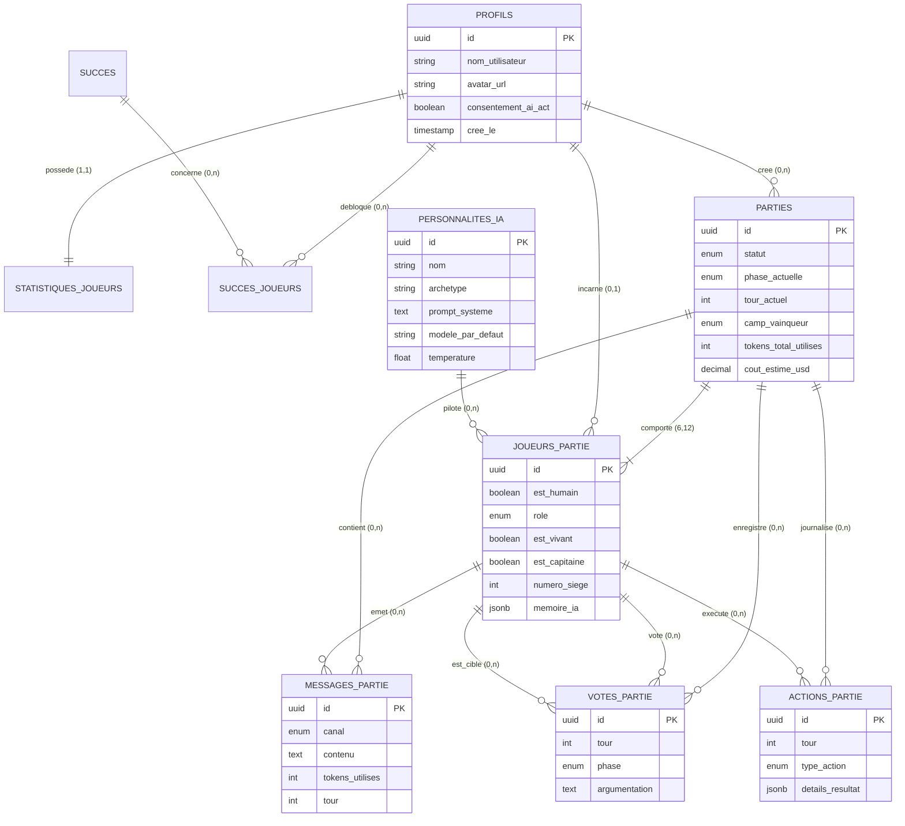

# 🌙 Studio Lanterne — Créatures de la Nuit vs IA

> Plateforme web de jeu de déduction sociale numérique permettant à un joueur humain d'affronter en solo plusieurs agents d'intelligence artificielle aux personnalités marquées et aux stratégies divergentes.

<p align="center">
  
</p>

---

## 📋 Contexte & Cahier des Charges

Le **Studio Lanterne**, éditeur indépendant de jeux de société numériques, constate la difficulté d'organiser des parties de déduction sociale en ligne (réunir 6 à 12 joueurs simultanément). Les robots existants étant scriptés et prévisibles, le studio a commandé une plateforme originale (**Créatures de la Nuit**, libre de droits) où les adversaires sont pilotés par des LLM dotés de personnalités uniques, capables de bluffer, accuser, débattre et comploter en secret.

### Exigences Clés du Client :
* **Agents IA Expressifs & Stratèges :** Au moins 5 agents par partie avec des archétypes distincts (*mauvais joueur, stratège, drôle, paranoïaque, mystique*).
* **Communication Secrète Nocturne :** Chat secret de nuit réservé aux Créatures de la Nuit, hermétiquement clos vis-à-vis des Citoyens.
* **Moteur de Règles Strict (Anti-Triche) :** Aucune décision ou hallucination d'un agent ne peut modifier l'état de jeu sans validation du moteur backend.
* **Maîtrise des Coûts (Low-Cost) :** Suivi en temps réel des tokens et du coût par partie avec modèles optimisés (Groq / Llama 3.1, Mistral Small, Gemini 1.5 Flash via LiteLLM).
* **Conformité RGPD & AI Act :** Information explicite du joueur sur la nature artificielle de ses adversaires, minimisation des données collectées, suppression en cascade.
* **Comptes Sécurisés & Gamification :** Authentification sécurisée, statistiques de parties et succès déblocables (*achievements*).

---

## 🛠️ Stack Technologique

| Composant | Technologie | Rôle & Justification |
| :--- | :--- | :--- |
| **Frontend** | **React / TypeScript / Tailwind CSS** | Interface immersive avec chat en direct, animations jour/nuit et vote interactif. |
| **Backend** | **Python / FastAPI (Asynchrone)** | Moteur de règles déterministe, gestion des WebSockets et orchestration asynchrone des agents. |
| **Base de Données & Auth** | **Supabase (PostgreSQL 17)** | Authentification JWT, RLS anti-triche, persistance des états, métriques de tokens. |
| **Modèles d'IA** | **Mistral AI, Groq (Llama 3), Gemini** | Approche multi-fournisseurs unifiée par **LiteLLM** pour diversifier le comportement des agents. |
| **Déploiement & CI/CD** | **Google Cloud Run / GitHub Actions** | Hébergement serverless à coût nul hors utilisation. |

---

## 🗄️ Architecture de la Base de Données (PostgreSQL / Supabase)

L'ensemble du modèle de données est entièrement nommé en **français** pour correspondre aux spécifications métier du Studio Lanterne.

<p align="center">
  
</p>
<p align="center">
  <em>Visualisation vectorielle interactive haute fidélité disponible : <a href="roadmap/studio_lantern/schema_tables.svg">schema_tables.svg</a></em>
</p>

---

### 1. Modèle Conceptuel de Données (MCD)



---

### 2. Modèle Logique de Données (MLD)

* **`profils`** (<u>id</u>, nom_utilisateur, avatar_url, consentement_ai_act, date_consentement_ai_act, cree_le, mis_a_jour_le)  
  *Clé étrangère : `id` → `auth.users(id)` ON DELETE CASCADE*
* **`statistiques_joueurs`** (<u>#joueur_id</u>, parties_jouees, parties_gagnees, parties_perdues, victoires_citoyens, victoires_creatures, victoires_solo, temps_de_jeu_total_secondes, mis_a_jour_le)  
  *Clé étrangère : `joueur_id` → `profils(id)`*
* **`succes`** (<u>id</u>, code, titre, description, icone_badge, points, cree_le)
* **`succes_joueurs`** (<u>#joueur_id, #succes_id</u>, debloque_le)  
  *Clés étrangères : `joueur_id` → `profils(id)`, `succes_id` → `succes(id)`*
* **`personnalites_ia`** (<u>id</u>, nom, archetype, avatar_url, prompt_systeme, modele_par_defaut, temperature, cree_le)
* **`parties`** (<u>id</u>, #hote_id, statut, phase_actuelle, tour_actuel, camp_vainqueur, tokens_total_utilises, cout_estime_usd, date_limite_phase, creee_le, terminee_le)  
  *Clé étrangère : `hote_id` → `profils(id)`*
* **`joueurs_partie`** (<u>id</u>, #partie_id, est_humain, #joueur_id, #personnalite_ia_id, nom_affiche, avatar_url, role, est_vivant, est_capitaine, tour_mort, cause_mort, numero_siege, memoire_ia, cree_le)  
  *Clés étrangères : `partie_id` → `parties(id)`, `joueur_id` → `profils(id)`, `personnalite_ia_id` → `personnalites_ia(id)`*
* **`messages_partie`** (<u>id</u>, #partie_id, #joueur_emetteur_id, canal, tour, phase, contenu, est_ia, tokens_utilises, cree_le)  
  *Clés étrangères : `partie_id` → `parties(id)`, `joueur_emetteur_id` → `joueurs_partie(id)`*
* **`votes_partie`** (<u>id</u>, #partie_id, tour, phase, #joueur_votant_id, #joueur_cible_id, argumentation, cree_le)  
  *Clés étrangères : `partie_id` → `parties(id)`, `joueur_votant_id` → `joueurs_partie(id)`, `joueur_cible_id` → `joueurs_partie(id)`*
* **`actions_partie`** (<u>id</u>, #partie_id, tour, #joueur_acteur_id, type_action, #joueur_cible_id, details_resultat, cree_le)  
  *Clés étrangères : `partie_id` → `parties(id)`, `joueur_acteur_id` → `joueurs_partie(id)`, `joueur_cible_id` → `joueurs_partie(id)`*

---

### 3. Fonctionnalités Métier Implémentées en Base

#### A. Cloisonnement et Chat Secret (Créatures & Morts)
Le canal des messages (`messages_partie.canal`) supporte 4 canaux étanches :
* `village_public` : accessible à tous les joueurs vivants.
* `creature_secret` : protégé par **Row Level Security (RLS)** — le joueur humain ne peut requêter ces lignes que si son rôle est `creature`.
* `chat_morts` : réservé aux joueurs éliminés.
* `systeme` : annonces publiques du meneur de jeu.

#### B. Suivi Automatisé des Coûts et Tokens (Low-Cost)
Un trigger SQL (`sur_ajout_message_token`) calcule et incrémente automatiquement le nombre total de tokens consommés et le coût estimé en dollars dans la table `parties` dès qu'un message d'agent IA est inséré.

#### C. Sécurité, RGPD & AI Act
* **Délégation d'Authentification Supabase (`auth.users`) :** C'est le module sécurisé de Supabase qui gère l'email, la cryptographie, le salage et le hachage des mots de passe (bcrypt). Stocker un mot de passe dans une table publique comme `profils` serait une faille de sécurité majeure. La table `profils` sert de pont via l'identifiant `UUID` (`id REFERENCES auth.users(id)`), séparant hermétiquement les données d'identification sécurisées des informations publiques de jeu (pseudo, avatar).
* **AI Act :** Champ `consentement_ai_act` obligatoire et horodaté lors de l'on-boarding. Les messages indiquent explicitement `est_ia = true`.
* **RGPD :** Aucune donnée personnelle superflue n'est collectée (aucun nom de famille ni adresse). La suppression d'un compte utilisateur propage une suppression en cascade (`ON DELETE CASCADE`) sur toutes ses données de jeu associées.

#### D. Catalogue des 5 Personnalités Initiales (Seed Multi-Modèles LiteLLM)
1. **Gérard le Râleur** (`mauvais_joueur` — `groq/llama-3.1-8b-instant`) : Leader agressif, méfiant, impulsif et prompt à accuser.
2. **Elena la Stratège** (`stratege` — `mistral/mistral-small-latest`) : Logicienne méfiante, analytique, probabiliste et méthodique.
3. **Bob le Rigolo** (`drole` — `gemini/gemini-1.5-flash`) : Bluffeur imperturbable, humour absurde et fausse naïveté.
4. **Sœur Béatrice** (`mystique` — `mistral/mistral-small-latest`) : Diplomate mystique, intuition divine et déclarations prophétiques.
5. **Lucas le Paranoïaque** (`paranoiaque` — `groq/llama-3.1-8b-instant`) : Suiveur nerveux, craintif, influençable et obsédé par les complots.

---

## 🚀 Fichiers SQL et Déploiement Supabase

```bash
# 1. Schéma des tables en français avec triggers et politiques RLS
supabase/migrations/20261103000000_initial_schema.sql

# 2. Données initiales (5 personnalités IA et succès)
supabase/seed.sql
```

---

## 🎮 Règles du Jeu & Rôles (Créatures de la Nuit)

Une partie oppose **6 joueurs** (**1 joueur humain** face à **5 agents IA**) répartis secrètement en deux camps rivaux :

### Les 5 Rôles Jouables :
| Rôle | Camp | Pouvoirs & Spécificités |
| :--- | :--- | :--- |
| **L'Inquisiteur** | Citoyens | S'éveille chaque nuit pour sonder l'alignement (`citoyens` ou `creatures`) d'un joueur vivant. |
| **L'Alchimiste** | Citoyens | Dispose d'une potion de Vie (sauve la victime nocturne, auto-sauvetage interdit) et d'une potion de Mort (élimine un joueur). Usage unique par potion. |
| **Le Garde du Corps** | Citoyens | S'il est éliminé (de nuit comme de jour), abat immédiatement un joueur vivant de son choix dans son dernier souffle (`tour_garde_du_corps`). |
| **Le Citoyen** | Citoyens | Dépourvu de pouvoirs nocturnes. S'appuie sur la logique, la rhétorique et l'analyse des votes lors des débats publics. |
| **La Créature (x2)** | Créatures | Connaît son allié nocturne. Délibère en secret sur le canal `creature_secret` la nuit pour désigner une victime, et dupe le village le jour. |

### Cycle des Phases (FSM Moteur Backend) :
1. **Nuit (`nuit`) :** Concertation secrète des Créatures + inspection de l'Inquisiteur.
2. **Tour de l'Alchimiste (`tour_alchimiste`) :** Choix d'utiliser ou non les potions de Vie/Mort.
3. **Annonce de l'Aube :** Résolution des morts nocturnes par le moteur backend et tir éventuel du Garde du Corps (`tour_garde_du_corps`).
4. **Débat Public (`debat_jour`) :** Deux tours de table publics où chaque survivant exprime ses soupçons dans le canal `village_public`.
5. **Vote du Conseil (`vote_jour`) :** Vote à la majorité relative pour éliminer un suspect. En cas d'égalité stricte, aucun joueur n'est éliminé.

### Conditions de Fin de Partie :
* **Victoire des Citoyens :** Toutes les Créatures de la Nuit ont été éliminées (`0` créature restante).
* **Victoire des Créatures :** Parité numérique atteinte (`nb_creatures >= nb_citoyens`).
* **Égalité :** Tous les joueurs meurent simultanément (`0` survivant).

---

## ⚙️ Guide d'Installation & Démarrage Rapide

### Prérequis
* **Node.js** (v20+ recommandé) et **npm**
* **Python** (3.11 ou supérieur)
* Un projet **Supabase** (gratuit) ou une instance PostgreSQL locale
* Une clé d'accès LLM (**Groq**, **Mistral** ou **Gemini**)

---

### 1. Configuration des Variables d'Environnement
Dupliquez le fichier d'exemple dans le dossier `backend` :
```bash
cp backend/.env.example backend/.env
```
Renseignez vos clés d'API dans `backend/.env` :
```env
SUPABASE_URL=https://votre-projet.supabase.co
SUPABASE_ANON_KEY=votre-cle-anon
SUPABASE_SERVICE_ROLE_KEY=votre-cle-service-role
GROQ_API_KEY=gsk_...
MISTRAL_API_KEY=...
GEMINI_API_KEY=...
```

---

### 2. Démarrer le Backend (FastAPI)
```bash
# Se placer dans le répertoire backend
cd backend

# Créer et activer l'environnement virtuel
python3 -m venv .venv
source .venv/bin/activate  # Sur Windows : .venv\Scripts\activate

# Installer les dépendances
pip install -r requirements.txt

# Lancer le serveur backend
uvicorn app.main:app --host 127.0.0.1 --port 8000 --reload
```
> Le serveur backend est accessible sur **http://127.0.0.1:8000** et sa documentation interactive OpenAPI Swagger sur **http://127.0.0.1:8000/docs**.

---

### 3. Démarrer le Frontend (React / Vite)
Dans un nouveau terminal :
```bash
# Se placer dans le répertoire frontend
cd frontend

# Installer les dépendances (dont polices et composants UI)
npm install

# Démarrer le serveur Vite
npm run dev
```
> L'application est jouable sur **http://127.0.0.1:5173**. Vite redirige automatiquement les appels `/api` vers le backend sur le port `8000`.

---

## 🧪 Tests & Assurance Qualité

### Tests Automatisés Backend (Pytest)
La suite de tests vérifie l'intégrité de la machine à états (FSM), la prévention des fuites de contexte (anti-triche), et la conformité des règles du jeu :
```bash
cd backend
source .venv/bin/activate
pytest tests/
```
* **`test_api.py`** : Endpoints REST, isolation stricte des canaux secrets (Row Level Security).
* **`test_fsm.py`** : Transitions d'états conformes, calcul de fin de partie.
* **`test_rules.py`** : Validations métier (interdiction d'auto-vote, gestion des égalités, pouvoirs).
* **`test_context_leak.py`** : Hermétisme des prompts LLM pour garantir qu'aucun rôle secret n'est fuité aux agents Citoyens.

### Validation Frontend (TypeScript & Lint)
```bash
cd frontend
npm run typecheck    # Vérification stricte des types TypeScript
npm run build        # Validation du build de production Vite
```


