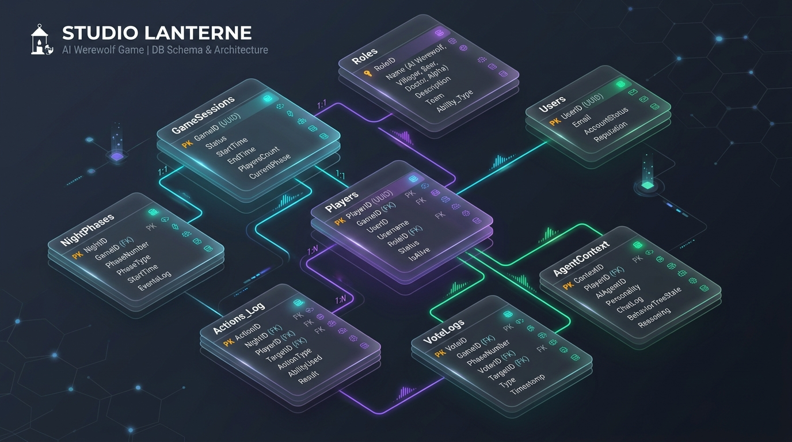
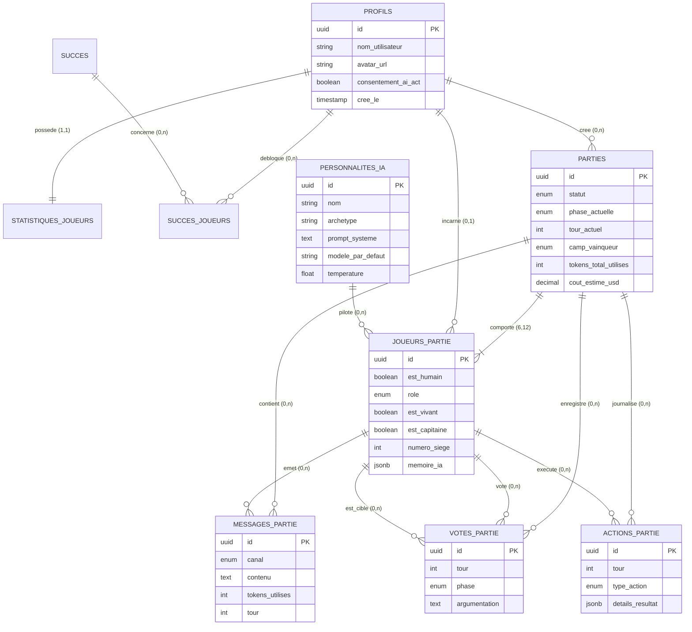

# 🐺 Studio Lanterne — Plateforme Loup-Garou vs IA

> Plateforme web de jeu de société numérique permettant à un joueur humain d'affronter en solo plusieurs agents d'intelligence artificielle aux personnalités marquées et aux stratégies divergentes.

<p align="center">
  
</p>

---

## 📋 Contexte & Cahier des Charges

Le **Studio Lanterne**, éditeur indépendant de jeux de société numériques, constate la difficulté d'organiser des parties de Loup-Garou en ligne (réunir 6 à 12 joueurs simultanément). Les robots existants étant scriptés et prévisibles, le studio a commandé une plateforme où les adversaires sont pilotés par des LLM dotés de personnalités uniques, capables de bluffer, accuser, débattre et comploter en secret.

### Exigences Clés du Client :
* **Agents IA Expressifs & Stratèges :** Au moins 5 agents par partie avec des archétypes distincts (*mauvais joueur, stratège, drôle, paranoïaque, mystique*).
* **Communication Secrète Nocturne :** Chat secret de nuit réservé aux Loups-Garous, hermétiquement clos vis-à-vis des villageois.
* **Moteur de Règles Strict (Anti-Triche) :** Aucune décision ou hallucination d'un agent ne peut modifier l'état de jeu sans validation du moteur backend.
* **Maîtrise des Coûts (Low-Cost) :** Suivi en temps réel des tokens et du coût par partie avec modèles optimisés (ex. Mistral Small, Groq / Llama 3).
* **Conformité RGPD & AI Act :** Information explicite du joueur sur la nature artificielle de ses adversaires, minimisation des données collectées, suppression en cascade.
* **Comptes Sécurisés & Gamification :** Authentification sécurisée, statistiques de parties et succès déblocables (*achievements*).

---

## 🛠️ Stack Technologique

| Composant | Technologie | Rôle & Justification |
| :--- | :--- | :--- |
| **Frontend** | **React / TypeScript / Tailwind CSS** | Interface immersive avec chat en direct, animations jour/nuit et vote interactif. |
| **Backend** | **Python / FastAPI (Asynchrone)** | Moteur de règles déterministe, gestion des WebSockets et orchestration asynchrone des agents. |
| **Base de Données & Auth** | **Supabase (PostgreSQL 17)** | Authentification JWT, RLS anti-triche, persistance des états, métriques de tokens. |
| **Modèles d'IA** | **Mistral AI, Groq (Llama 3), Gemini** | Approche multi-fournisseurs unifiée par **LiteLLM** pour diversifier le comportement des agents. |
| **Déploiement & CI/CD** | **Google Cloud Run / GitHub Actions** | Hébergement serverless à coût nul hors utilisation. |

---

## 🗄️ Architecture de la Base de Données (PostgreSQL / Supabase)

L'ensemble du modèle de données est entièrement nommé en **français** pour correspondre aux spécifications métier du Studio Lanterne.

<p align="center">
  
</p>
<p align="center">
  <em>Visualisation vectorielle interactive haute fidélité disponible : <a href="roadmap/studio_lantern/schema_tables.svg">schema_tables.svg</a></em>
</p>

---

### 1. Modèle Conceptuel de Données (MCD)



---

### 2. Modèle Logique de Données (MLD)

* **`profils`** (<u>id</u>, nom_utilisateur, avatar_url, consentement_ai_act, date_consentement_ai_act, cree_le, mis_a_jour_le)  
  *Clé étrangère : `id` → `auth.users(id)` ON DELETE CASCADE*
* **`statistiques_joueurs`** (<u>#joueur_id</u>, parties_jouees, parties_gagnees, parties_perdues, victoires_villageois, victoires_loups_garous, victoires_solo, temps_de_jeu_total_secondes, mis_a_jour_le)  
  *Clé étrangère : `joueur_id` → `profils(id)`*
* **`succes`** (<u>id</u>, code, titre, description, icone_badge, points, cree_le)
* **`succes_joueurs`** (<u>#joueur_id, #succes_id</u>, debloque_le)  
  *Clés étrangères : `joueur_id` → `profils(id)`, `succes_id` → `succes(id)`*
* **`personnalites_ia`** (<u>id</u>, nom, archetype, avatar_url, prompt_systeme, modele_par_defaut, temperature, cree_le)
* **`parties`** (<u>id</u>, #hote_id, statut, phase_actuelle, tour_actuel, camp_vainqueur, tokens_total_utilises, cout_estime_usd, date_limite_phase, creee_le, terminee_le)  
  *Clé étrangère : `hote_id` → `profils(id)`*
* **`joueurs_partie`** (<u>id</u>, #partie_id, est_humain, #joueur_id, #personnalite_ia_id, nom_affiche, avatar_url, role, est_vivant, est_capitaine, tour_mort, cause_mort, numero_siege, memoire_ia, cree_le)  
  *Clés étrangères : `partie_id` → `parties(id)`, `joueur_id` → `profils(id)`, `personnalite_ia_id` → `personnalites_ia(id)`*
* **`messages_partie`** (<u>id</u>, #partie_id, #joueur_emetteur_id, canal, tour, phase, contenu, est_ia, tokens_utilises, cree_le)  
  *Clés étrangères : `partie_id` → `parties(id)`, `joueur_emetteur_id` → `joueurs_partie(id)`*
* **`votes_partie`** (<u>id</u>, #partie_id, tour, phase, #joueur_votant_id, #joueur_cible_id, argumentation, cree_le)  
  *Clés étrangères : `partie_id` → `parties(id)`, `joueur_votant_id` → `joueurs_partie(id)`, `joueur_cible_id` → `joueurs_partie(id)`*
* **`actions_partie`** (<u>id</u>, #partie_id, tour, #joueur_acteur_id, type_action, #joueur_cible_id, details_resultat, cree_le)  
  *Clés étrangères : `partie_id` → `parties(id)`, `joueur_acteur_id` → `joueurs_partie(id)`, `joueur_cible_id` → `joueurs_partie(id)`*

---

### 3. Fonctionnalités Métier Implémentées en Base

#### A. Cloisonnement et Chat Secret (Loups & Morts)
Le canal des messages (`messages_partie.canal`) supporte 4 canaux étanches :
* `village_public` : accessible à tous les joueurs vivants.
* `loup_garou_secret` : protégé par **Row Level Security (RLS)** — le joueur humain ne peut requêter ces lignes que si son rôle est `loup_garou`.
* `chat_morts` : réservé aux joueurs éliminés.
* `systeme` : annonces publiques du meneur de jeu.

#### B. Suivi Automatisé des Coûts et Tokens (Low-Cost)
Un trigger SQL (`sur_ajout_message_token`) calcule et incrémente automatiquement le nombre total de tokens consommés et le coût estimé en dollars dans la table `parties` dès qu'un message d'agent IA est inséré.

#### C. Sécurité, RGPD & AI Act
* **Délégation d'Authentification Supabase (`auth.users`) :** C'est le module sécurisé de Supabase qui gère l'email, la cryptographie, le salage et le hachage des mots de passe (bcrypt). Stocker un mot de passe dans une table publique comme `profils` serait une faille de sécurité majeure. La table `profils` sert de pont via l'identifiant `UUID` (`id REFERENCES auth.users(id)`), séparant hermétiquement les données d'identification sécurisées des informations publiques de jeu (pseudo, avatar).
* **AI Act :** Champ `consentement_ai_act` obligatoire et horodaté lors de l'on-boarding. Les messages indiquent explicitement `est_ia = true`.
* **RGPD :** Aucune donnée personnelle superflue n'est collectée (aucun nom de famille ni adresse). La suppression d'un compte utilisateur propage une suppression en cascade (`ON DELETE CASCADE`) sur toutes ses données de jeu associées.

#### D. Catalogue des 5 Personnalités Initiales (Seed)
1. **Gérard le Râleur** (`mauvais_joueur`) : Méfiant, agressif et prompt à accuser.
2. **Elena la Stratège** (`stratege`) : Analytique, probabiliste et méthodique.
3. **Bob le Rigolo** (`drole`) : Humour absurde et fausse naïveté.
4. **Sœur Béatrice** (`mystique`) : Intuition divine et déclarations prophétiques.
5. **Lucas le Paranoïaque** (`paranoiaque`) : Craintif, influençable et obsédé par les complots.

---

## 🚀 Fichiers SQL et Déploiement Supabase

```bash
# 1. Schéma des tables en français avec triggers et politiques RLS
supabase/migrations/20261103000000_initial_schema.sql

# 2. Données initiales (5 personnalités IA et succès)
supabase/seed.sql
```
